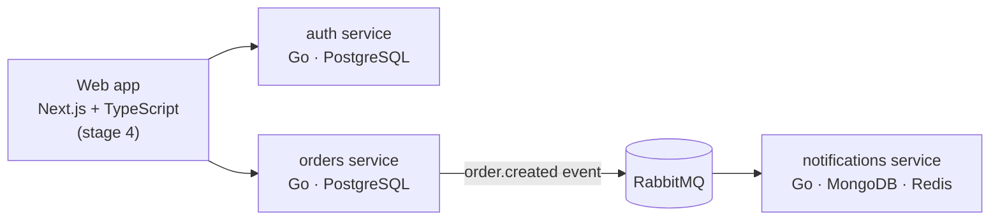

# OrderOps — Order & Operations Platform

A small microservices platform for food-delivery style operations: customers
place orders, couriers deliver them, and every step emits events that other
services react to. Built as a portfolio-grade demonstration of a production
Go + React stack.

## Architecture



| Service | Stack | Responsibility |
| --- | --- | --- |
| `services/auth` | Go, PostgreSQL, JWT | Users, registration, login, roles (customer / courier / admin) |
| `services/orders` | Go, PostgreSQL, RabbitMQ | Orders and line items; publishes `order.created` events |
| `services/notifications` | Go, MongoDB, Redis | Consumes order events, writes audit log, caches hot reads |

Infrastructure (Postgres, Redis, MongoDB, RabbitMQ and all services) runs
with one `docker compose up`.

## Tech stack

- **Backend:** Go (stdlib HTTP routing), pgx, JWT (HS256), bcrypt
- **Frontend:** Next.js, React, TypeScript, Tailwind CSS, TanStack Query,
  Zustand, React Hook Form + Zod *(stage 4)*
- **Data:** PostgreSQL, MongoDB, Redis
- **Messaging:** RabbitMQ (event-driven between services)
- **DevOps:** Docker + Compose, GitHub Actions CI, unit tests per service

## Quick start

```sh
cp .env.example .env
docker compose up --build
# auth service → http://localhost:8081/healthz
```

Try it:

```sh
# 1. Register and log in (auth service)
curl -X POST localhost:8081/register \
  -H 'Content-Type: application/json' \
  -d '{"name":"Ada","email":"ada@example.com","password":"supersecret","role":"customer"}'
TOKEN=$(curl -s -X POST localhost:8081/login \
  -H 'Content-Type: application/json' \
  -d '{"email":"ada@example.com","password":"supersecret"}' | jq -r .token)

# 2. Create an order (orders service) — this publishes an order.created
#    event to RabbitMQ via the transactional outbox
curl -X POST localhost:8082/orders \
  -H "Authorization: Bearer $TOKEN" -H 'Content-Type: application/json' \
  -d '{"store_name":"Warung Sederhana","address":"Jl. Merdeka No. 1",
       "items":[{"name":"Nasi Goreng","qty":2,"price":15000},
                 {"name":"Es Teh","qty":1,"price":5000}],
       "delivery_fee":7000}'
```

## Development

```sh
make test        # unit tests for all Go services
make up          # start infrastructure only (for running services locally)
make run-auth    # run the auth service against that infrastructure
```

## Build stages

1. **Foundation + auth service** — repo layout, Compose infra, CI, auth API ✅
2. **Orders service + RabbitMQ events** — orders CRUD, status lifecycle,
   transactional outbox → `order.created` events ✅
3. Notifications service + MongoDB audit + Redis
4. Next.js web frontend
5. Polish: diagrams, screenshots, demo pass

See `RENCANA.md` (Indonesian) for the full plan and stage log.
